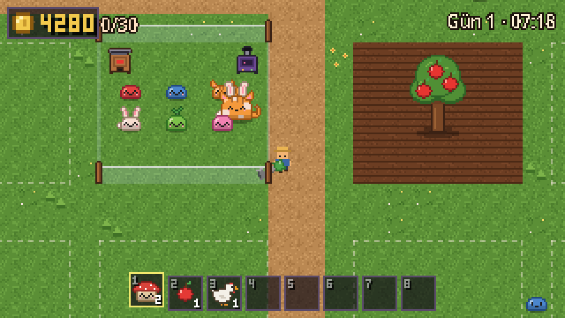
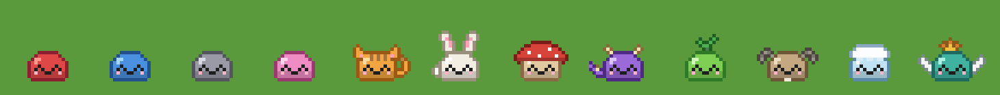
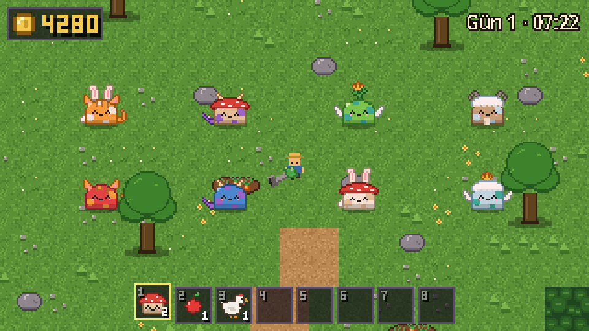
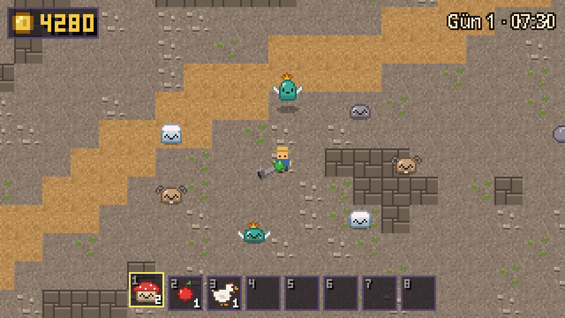
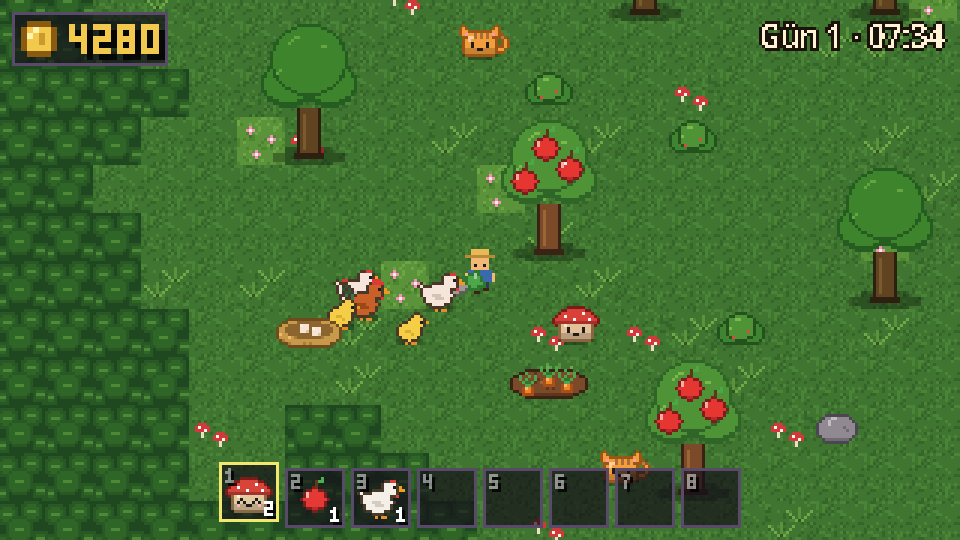

# Slime Farm

Godot 4.6 ile yapılmış, yukarıdan bakışlı piksel art bir slime çiftliği oyunu. Vakum
silahınla slimeları, yiyecekleri ve gemleri topla. Slimeları besle, gemlerini sat ve
kazandığın parayla çiftliğini büyüt.



## Slime türleri



| Tür | Özelliği | Nerede | Ne yer | Favorisi |
|---|---|---|---|---|
| Kırmızı | — | Çiftlik | Meyve | Elma |
| Mavi | — | Çiftlik, orman | Sebze | Pancar |
| Gri | — | Yayla, dağlar | Et | Kaya tavuğu |
| Pembe | — | Orman, yayla | Hepsi | Yıldız meyvesi |
| Kedi | Sivri kulaklar, kıvrık kuyruk, tekir çizgileri | Orman | Et | Tavuk |
| Tavşan | Uzun kulaklar, pamuk kuyruk | Yayla | Sebze | Havuç |
| Mantar | Benekli mantar şapka | Orman | Meyve | Ay üzümü |
| Ejder | Boynuzlar, dikenli kuyruk | Yayla | Et | Horoz |
| Yaprak | Başında filiz | Orman | Sebze | Pancar |
| Keçi | Koç boynuzları, sakal | Dağlar | Sebze | Buz turpu |
| Kar | Kar örtüsü | Dağlar | Meyve | Yıldız meyvesi |
| Tüy | İbik, küçük kanatlar | Dağlar | Et | Kaya tavuğu |

### Büyük slimelar

Bir slime başka türün gemini yerse **büyük slime**'a dönüşür. Büyük slime'ın
gövdesi bir türün renginde olur, öbür türün rengi gövdede benek olarak görünür.
**İki türün özellikleri birlikte taşınır**: kedi + tavşan hem kedi kulaklı hem
tavşan kulaklıdır. İki türün yediği her şeyi yer ve her doyduğunda iki gem verir.
12 türden 66 farklı büyük slime çıkar.



## Özellikler

- **Vakum silahı:** Sağ tık ile slimeları, yiyecekleri ve gemleri çeker, sol tık ile fırlatır.
  Fırlatılan nesneler slimelara çarpıp seker.
- **Beslenme:** Her tür ya meyve (elma, yıldız meyvesi, ay üzümü), ya sebze (havuç, pancar,
  buz turpu), ya da et (tavuk, horoz, kaya tavuğu) yer. Aç bir slime istediği yiyeceğin
  ikonunu kafasının üstünde gösterir.
- **Favori yiyecek:** Her slime'ın bir favorisi var (büyük slimeların iki). Favorisini
  yiyen slime iki kat gem verir.
- **Slime Kitabı (B):** Yakaladığın türlerin adı, resmi, yaşadığı yer, beslenmesi ve
  favorisi. Henüz yakalanmamış türler gizli.
- **Tavuklar:** Yuvalarda tavuk, horoz ve civciv çıkar; taş yuvalarda kaya tavuğu.
  Civcivler zamanla büyür.
- **Bölgeler:** Çitli çiftlik, batıda orman, kuzeyde yayla, doğuda karlı ve geniş dağlar.
- **Ağaçlar ve havuçlar:** Elma ağaçlarında ve toprak yığınlarında ürünler kendiliğinden yenilenir.
- **Bahçe arsaları:**
  - **Slime kümesi:** otomatik besleyici, otomatik gem toplayıcı ve 16 slime'a genişletme
    eklenebilir.
  - **Tarla:** içine elma ya da havuç atınca fidan büyüyüp sınırsız ürün veren bir kaynağa
    dönüşür. Gübre ile daha hızlı büyür.
  - Kümes ve tarla kaldırılabilir.
- **Gece-gündüz döngüsü:** Bir oyun günü 3 dakika sürer.
- **Ev ve kayıt:** Yatakta uyuyunca oyun kaydedilir. 3 kayıt slotu var.
- **Ses efektleri** ve bir **debug paneli** (F1) var.

| Dağlar | Orman |
|---|---|
|  |  |

## Kontroller

| Tuş | İşlev |
|---|---|
| WASD / ok tuşları | Hareket |
| Fare | Nişan alma |
| Sağ tık (basılı tut) | Vakumla çek |
| Sol tık | Seçili slottakini fırlat |
| 1-8 / fare tekerleği | Envanter slotu seç |
| E | Etkileşim (yatak, arsa menüsü, gem toplayıcı) |
| B | Slime Kitabı |
| F1 | Debug paneli: hız, zaman, para, ışınlanma … |
| Esc | Menüyü kapat |

## Çalıştırma

1. [Godot 4.6](https://godotengine.org/download)'yı indir.
2. Godot'ta **Import** ile bu klasördeki `project.godot` dosyasını aç.
3. **F5** ile oyunu başlat.

## Görseller ve sesler

Oyundaki bütün piksel art ve ses efektleri koddan üretilir; dosyaları elle düzenlemek
gerekmez:

```sh
godot --headless --path . -s res://tools/generate_assets.gd   # assets/*.png
godot --headless --path . -s res://tools/generate_sounds.gd   # assets/sfx/*.wav
godot --headless --path . --import
```

## Proje yapısı

```
scenes/   sahneler (.tscn)
scripts/  oyun kodu (GDScript, statik tipli)
data/     eşya ve slime verileri (.tres)
assets/   üretilmiş görseller, sesler, tileset
tools/    görsel ve ses üreteçleri
docs/     geliştirme kaydı (DEVLOG.md) ve README görselleri
```

Sistemlerin ayrıntılı açıklaması, kayıt biçimi ve test yöntemi
[`docs/DEVLOG.md`](docs/DEVLOG.md) dosyasında.
